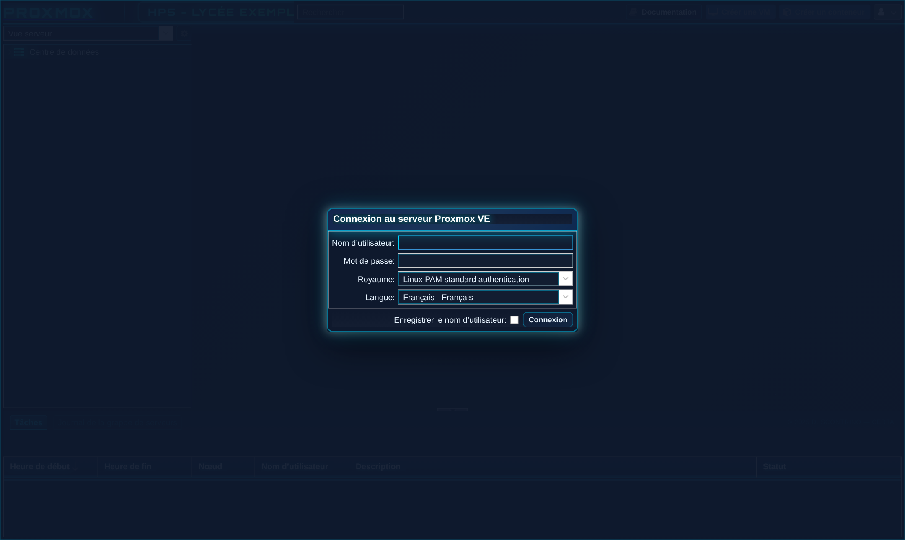
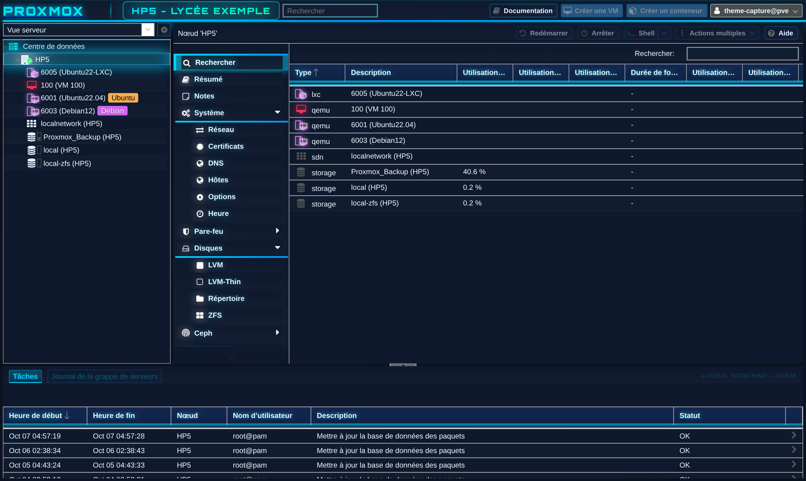

# Thème néon cyberpunk pour Proxmox VE

Thème bleu néon pour l'interface web de Proxmox VE 8 et 9. Je l'ai fait pour mes salles de BTS SIO et je le partage avec les collègues.

Un seul script Bash, lancé en root, avec un menu. Rien à installer ni à télécharger en plus (la police est dans le script), et tout se retire en une commande.





## Ce que fait le thème

- fond sombre animé, menus, fenêtres et graphiques assortis
- icônes colorées selon l'état : VM arrêtée, VM en marche, modèle
- un badge dans la barre du haut : le nom du nœud par défaut, ou le texte de votre choix
- en option (désactivé par défaut) : un message d'accueil après la connexion
- en option (désactivé par défaut) : plus de fenêtre "No valid subscription". Les boutons qui l'affichaient (Mises à jour, Dépôts...) marchent normalement.

C'est un thème sombre : il force le mode sombre de Proxmox, même si le navigateur était réglé en clair. À la désinstallation, on retrouve son réglage.

## Installation

Sur le serveur, en root :

```bash
wget https://github.com/SCONTRINO-Hub/proxmox-theme-neon-cyberpunk/releases/latest/download/install_theme_proxmox.sh
chmod +x install_theme_proxmox.sh
./install_theme_proxmox.sh
```

Le menu propose d'installer (ou mettre à jour) et de désinstaller. Il pose quatre questions : le badge, le message d'accueil, la fenêtre d'abonnement et le retour automatique après une mise à jour. La réponse proposée est toujours le réglage déjà en place.

Il suffit ensuite de rafraîchir la page avec Ctrl+F5. Aucun service n'est redémarré.

Pour le message d'accueil, écrivez-le d'abord dans un fichier (.html ou texte simple), puis donnez son chemin.

### Sans le menu

```bash
./install_theme_proxmox.sh --installer --badge "%NODE% - Lycée Exemple"
./install_theme_proxmox.sh --installer --message exemple_message_accueil.html --sans-abonnement
./install_theme_proxmox.sh --installer --auto-maj
```

`--installer` seul garde les réglages en place, seules les options passées les modifient. Les autres options :

| Option | Effet |
|---|---|
| `--sans-message` | retire le message d'accueil |
| `--avec-abonnement` | remet la fenêtre d'abonnement |
| `--sans-auto-maj` | arrête le retour automatique |
| `--desinstaller` | retire le thème |
| `--version` | version et empreinte du script |
| `--aide` | liste complète |

Les anciennes options de la V28 (`--auto`, `--install`, `--uninstall`, `--no-sub`) marchent toujours, et `%NOEUD%` est accepté comme `%NODE%`.

### En cluster

Chaque nœud sert sa propre interface : il faut lancer le script sur chaque nœud.

### Fichier copié depuis Windows

S'il a pris des fins de ligne Windows, le script le signale, ou le serveur répond `required file not found`. Pour le réparer :

```bash
sed -i 's/\r$//' install_theme_proxmox.sh
```

## Après une mise à jour de Proxmox

Une mise à jour de `pve-manager` remet l'interface d'origine : le thème disparaît, mais rien ne casse. Deux possibilités.

**Le thème revient tout seul** si vous avez répondu oui à la question du menu (ou avec `--auto-maj`). Le script ajoute alors un petit fichier, `/etc/apt/apt.conf.d/99-theme-proxmox-cyberpunk`. Après chaque passage d'apt, en ligne de commande ou depuis l'interface web, il relance une copie du script gardée dans `/usr/local/sbin/theme-proxmox-cyberpunk`. Si le thème est déjà en place, elle s'arrête tout de suite. En cas de problème elle ne dit rien, et une mise à jour n'échoue jamais à cause du thème. Un paquet installé à la main avec `dpkg -i` ne déclenche rien : le thème reviendra au prochain apt.

**Sinon** (réponse par défaut), relancez le script : au menu, 1 puis Entrée à chaque question, ou `--installer`. Les réglages sont repris.

## Fichiers modifiés

- `index.html.tpl` : 2 lignes `<link>` (le mode sombre de Proxmox, puis le thème), et une ligne `<script>` s'il y a un message d'accueil. Elles portent la marque `theme-proxmox-cyberpunk`, donc relancer le script ne les ajoute pas deux fois.
- une feuille de style (avec la police Orbitron) et, s'il y a un message, un petit script, dans `/usr/share/pve-manager/css/` et `/js/`
- `proxmoxlib.js`, seulement si on retire la fenêtre d'abonnement
- avec le retour automatique : `/etc/apt/apt.conf.d/99-theme-proxmox-cyberpunk` et `/usr/local/sbin/theme-proxmox-cyberpunk`
- une copie des fichiers d'origine dans `/var/backups/theme-proxmox-cyberpunk/`, tant que le thème est installé

Si la V28 était installée, il n'y a rien à faire : le script nettoie ce qu'elle avait laissé (`/opt/theme-proxmox-cyberpunk/`, journal, crochet apt) et garde ses réglages. Ses sauvegardes dans `/root/sauvegardes-theme-proxmox/` ne sont pas touchées, vous pouvez supprimer ce dossier quand vous n'en avez plus besoin.

## Désinstallation

Au menu, choix 2, ou :

```bash
./install_theme_proxmox.sh --desinstaller
```

Le script retire ses lignes et ses fichiers, y compris ceux du retour automatique. Pour la fenêtre d'abonnement, il enlève seulement sa propre modification de `proxmoxlib.js` : si un autre outil a aussi modifié ce fichier, ses changements sont conservés.

Guide d'une page : [guide_theme_proxmox.pdf](guide_theme_proxmox.pdf)

## Licence

- script, guide et captures : [CC BY-NC-SA 4.0](LICENSE) (pas d'usage commercial, citer l'auteur, partager dans les mêmes conditions)
- police Orbitron : © 2018 The Orbitron Project Authors, [SIL Open Font License 1.1](OFL-Orbitron.txt). Le texte de la licence est aussi à la fin du script.

## Auteur

Damien SCONTRINO, BTS SIO, lycée Louis Armand (Nogent-sur-Marne).

Les remarques et suggestions sont les bienvenues dans les issues du dépôt.
